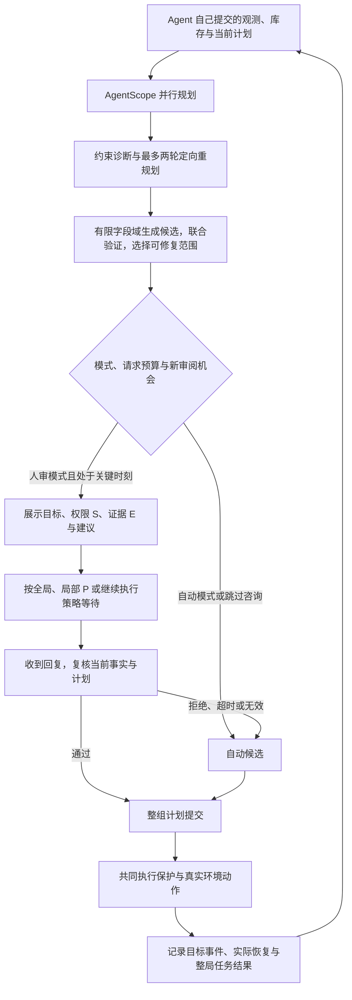

# 可修复范围与人审闭环：实现说明

日期：2026-11-16。本文对应当前代码；[原框架](research_framework_2026-11-16.md) 保留为设计依据。

## 1. 已接通的运行框架



MA-Crafter 继续使用原有 DAMCS 分层记忆、AgentScope Agent、导航和分享执行器。控制器在现有执行器之前统一提交计划补丁；不会直接发放材料或改写任务结果。普通导航不会因为未来缺工具而暂停，当前仍不可执行的制造或分享本步暂缓，下一步重新规划。

运行仍由单进程集中调度，各 Agent 的模型规划并发执行。本文没有把它描述为跨机器分布式运行。两轮重规划是每次规划周期的上限，API 重试与此分开计数。

## 2. 三个机制的实际边界

### 可修复编辑范围 S

`repair_scopes.py` 固定待恢复的制造/采集事件，枚举有限修改域，并按照真实的“先分享、再逐 Agent 执行动作”顺序联合投影。验证同时检查选定目标与未编辑计划原本可验证的工作；不会以全部等待作为修复。

选择依据依次为覆盖的即时目标数、采集目标数、编辑 Agent 数、修改字段数，即先修得全，再改得少。

2026-11-17 起，搜索默认不设编辑人数上限，按人数逐级加深：

- 1–2 人的范围总是完整搜索，H1 这类固定小范围策略仍能看到其中全部候选。
- 更大的范围只在还没有候选覆盖全部目标时继续搜索。一旦有候选覆盖全部目标，更大的范围只会多改人、不会被选中，所以停止。
- 联合检查总数超过预算 `ASSIGNMENT_BUDGET`（5 万次，Crafter 中约 4 秒）时停止，并在 `search_stop=assignment_budget` 中记录。
- 每次分析记录 `max_scope_agents`、`searched_scope_agents` 和 `search_stop`。

字段权限不变：只能改计划字段，不能改库存或环境，不可编辑的 Agent 不进入搜索。

现在有两个独立参数：

- `--scope_max_agents`（K）：搜索上限，默认不限。可设为 1 或 2，作为消融对照。
- `--review_max_agents`：一次人审最多开放的 Agent 数，默认 2，表示人的阅读上限。可修复范围超过该值时不发人审，记录 `review_skipped` 的 `over_review_capacity` 原因，然后走同一个自动后备分支。

自动分支使用同一份候选。人审批准并不代表恢复成功；只有实际执行产生对应成就或推块事件，才记为局部恢复。最后采到钻石或交付全部方块，另记为任务成功。

### 审阅证据 E

`review_evidence.py` 从库存读写、位置和格子读写构造依赖闭包，保留计划、位置、朝向、睡眠/死亡状态和原有保护义务作为背景。库存与局部观测按组删除；只有目标判定与保护义务仍能在缺失事实视为未知的模型中被证实时，才删除该组。

这里的“最小”是相对固定背景、以库存/观测组为粒度的删除极小，不是任意事实粒度的全局最小。充分性也只针对声明的一步规则模型，不保证人类一定理解。

CUBE 当前保留完整公开棋盘为一个事实组，不宣称已实现 CUBE 上的证据压缩收益。

### 等待范围 P 与增量复核

`intervention.py` 支持全局等待、依赖范围局部等待、继续执行三种模式。局部等待包含原计划和替代计划的读写影响，包括被取消的分享；等待期间新出现的相关操作也加入 P。分享在环境步进前发生，因此分享同样服从等待控制。

所有模式都推进环境时钟；等待的 Agent 执行 `noop`。未等待的 Agent 可以继续规划和行动。人工返回后检查权限、所审计划是否变化及当前联合条件；同一组修改在验证完成后一次性送入执行器。

增量模式对依赖范围复核。如果保留证据、原有保护义务、授权计划及建议均未变化，可复用已验证证书。完整复核作为可切换对照。环境中的后续 NPC、自主事件与未观测未来不在证书保证内。

## 3. 人审入口与预算

`--scope_mode human` 启动本地网页，默认地址 `http://127.0.0.1:8765`。界面提供目标、原计划、建议方案、授权字段、证据和候选选择；可以预检、采用建议、修改后提交或跳过。预检不修改模拟器。

审阅者保持列表页打开即可，页面不需要手动刷新：

- 列表页每 2 秒查询一次新请求，标签页标题显示待审数量，待审请求高亮并显示剩余秒数。
- 点一次"开启声音和桌面提醒"后，新请求到达时会发出提示音和桌面通知。
- 勾选"新请求到达时自动打开"（默认勾选）时，新请求会直接打开。阅读时间从打开请求页面开始计算。
- 请求页显示倒计时。超时、本局结束或请求已处理后，页面会提示并禁用按钮，迟到的回复会被拒绝，不会写入。
- 批量运行时每局在同一端口重启服务，列表页会自动接上下一局。

审阅者的操作步骤和判断标准见 [审阅规程](review_protocol_2026-11-18.md)。

2026-11-17 起，人审不再设每局次数额度，改为只在关键时刻问人。关键时刻默认由三个与环境无关的信号判断（`--review_trigger signals`），实现在 `InterventionController._signals`：

- `choice`：能修好该问题的已验证方案改的是不同的 Agent 集合，需要人决定打断谁。
- `unknown`：没有已验证方案，且搜索结果中存在因信息缺失而无法判定的范围。
- `stalled`：环境适配器的 `progress` 在一段时间内没有增长。这段时间默认是每局步数的 `--stall_fraction`（0.1，四舍五入且至少 1 步：Crafter 350 步对应 35 步，CUBE 30 步对应 3 步），`--stall_steps` 可改为固定步数；不知道每局步数时取 30 步。Crafter 的进度是全队达成的主线里程碑数（钻石链的 10 个阶段，2026-11-18 起；此前数全部成就，喝水、吃牛也算进度），CUBE 是团队得分。

问人时：

- 只针对被判为关键的问题；同一步的其他问题和所有未问人的情况都走同一个自动后备分支，事件 `review_skipped` 记录原因（`not_critical`、`cooldown`、`over_review_capacity` 等）。请求文件记录每个问题的触发信号（`trigger_signals`），审阅页面会显示。
- H（原 H2）开放所选修复涉及的 Agent，并在不超过 `--review_max_agents` 的前提下加入其他已验证方案涉及的 Agent，开放字段取这些方案实际修改字段的并集，人可以在已验证的方案之间选择。`unknown` 时没有已验证方案，开放问题涉及的 Agent（诊断中的证据组），字段全部开放。确定修不了的问题不开放。
- `unknown` 请求中，审阅者的修改检查结果仍为 unknown 时，只要它让至少一个"不改就确定修不好"的问题变得可能修好，就按审阅者的判断执行，记为 `human_vouched`；对任何问题都没有帮助、或会确定破坏其他工作的修改仍被拒绝。预检页面会提示属于哪种情况。
- 同一问题问过之后 `--review_cooldown`（默认 10）步内不再重复问。

其他选项：`--review_trigger stage` 使用环境适配器的固定名单（Crafter：做铁镐、采铁、采钻石，见 `review_domains.py` 的 `CRAFTER_CRITICAL_TARGETS`；CUBE：每次推箱失败）；`--review_trigger all` 对所有问题都问人，只用于练习；`--human_requests` 可设置每局上限，默认不设。

阅读/修改时间单独记录。超时 120 秒。`--review_step_seconds` 控制等待期间每个环境步的现实时间，实验各组应保持一致。

可用 `--reviewer scripted` 和 `--scripted_delay_steps` 检查固定延迟流程。此模式明确标记 `provider=scripted`，阅读时间为 0，不能进入真人增益统计。脚本采用建议本质上仍是自动选择，适合验证系统行为。

```powershell
python run.py --condition H --agent_num 6 --step_num 350 --review_max_agents 2 --pause_mode local --results_dir results\human_h --no_plot
```

需要单独运行表单服务时，使用 `python scripts\review_server.py --results_dir results\human_h2 --port 8765`，并将运行器的 `--review_port` 设为 0。

## 4. 对比与消融入口

正式要跑的三张表（主实验、部件消融、跨模型对比）及其统一设置、指标和运行前待办，见 [实验表设计](experiment_tables_2026-11-17.md)。2026-11-18 起表格条件为 A、B、C、H（B 为合法性修复，C 在其上自动处理"合法但慢"的计划，H 为 C 的人审版；编号变更见下文），设计见 [进度问题修复设计](progress_repair_design_2026-11-18.md)，实现见下面第 4.1 节。三张表都只跑 MA-Crafter；CUBE 的代码保留，可作附录，2026-11-18 起不进表格。2026-11-17 起补齐了运行三张表所需的部分：任意 OpenAI 兼容接口与命名模型配置（`config/model_profiles.json`、`scripts/run_with_model.py`）、独立的 Embedding 配置、表 2 的消融套件（`--suite ablation`，从 C 逐个去掉模块：`C-no-legality`、`C-no-llm`；模块内部的设计检验在 `--suite appendix`：`C-no-commit`、`Hscript`、`Hscript-global-wait`、`Hscript-no-recheck`）。`--agent_llm off` 让所有 Agent 一律给出 noop 计划，不调用对话模型和 Embedding，用于"只靠机制"的对照以及钻石步数、改动人数和费用等汇总字段。

| 条件 | 最终行为 | `--progress_mode` |
| --- | --- | --- |
| A | 自主规划，统一动作合法性保护 | `log`：只记录进度问题 |
| B | A + 合法性修复：最多两轮定向重规划，仍不合法时由可修复范围 S 自动选择、提交与执行 | `log` |
| C | B + 进度问题自动修复（采用排第一的方案） | `auto` |
| H | C 的人审版：不合法问题和进度问题在关键时刻都问人，其余同 C | `human` |

条件定义在 `memory_system/experiments.py` 的 `CONDITIONS`。H 的不合法问题人审沿用原 H2：开放可修复范围，字段收缩到所选见证的实际修改字段。`--review_strategy owner`（原 H1 的"开放出问题的 Agent"）仍可用 `--condition custom` 运行，但不再是表格条件。只重规划、不用 S 的设置（第二次变更前的 B）也可以用 `--condition custom --coordination_mode repair --repair_rounds 2 --scope_mode off --progress_mode log` 运行。

编号变更：

- 2026-11-17：旧方案中覆盖完整关联组、开放全部字段的结构参照（当时叫 H1）已删除，因为它允许人在较大范围内自由修改，结果难以量化；原来的 H0 改名为 H1。
- 2026-11-18 第一次：H1、H2 合并为 H，新增自动进度修复的 D。旧结果中的 H2 相当于没有进度修复的 H。
- 2026-11-18 第二次：原 B（只重规划）和原 C（重规划 + S）合并为现在的 B，原 D 改名为 C。预试中 S 一次修复都没做过（原 C 的 149 次分析都没有可修目标；qwen3.8-max 关思考的 H2 重跑中 145 次无目标、4 次无解），原 B 与原 C 行为相同。S 留在代码里，作为合法性修复内部的兜底，不再单独算模块。旧结果中的 C 即现在的 B，D 即现在的 C。

### 4.1 进度问题修复（C、H）

设计理由见 [进度问题修复设计](progress_repair_design_2026-11-18.md)。代码分布：

- Crafter 部分在 `memory_system/progress_repair.py`。
- CUBE 部分在 `memory_system/progress_cube.py`。
- 页面和提示文字在 `memory_system/progress_text.py`。
- 控制器入口是 `InterventionController.prepare`、`_progress`、`_apply_progress`、`_progress_request`、`_resolve_progress`。

**每个规划步的流程**

1. **规划前（`prepare`）。** 锁定任务按当前观测给出本步计划。被锁定的 Agent 不调用 LLM，不参与重规划，也不会被不合法修复改动。
   - 解除锁定的条件：里程碑已达成（谁达成都算）、任务完成、走不通、睡着、生命值 ≤ 3、超出步数上限。
   - 解除时在该 Agent 的上下文里写明原因。
   - 任务一旦达成里程碑，环境步结束后就立即解除。
2. **不合法问题照旧处理。** B、C、H 先重规划，仍不合法时由可修复范围 S 修复（H 在关键时刻问人）。
3. **检查进度问题。** 在不合法修复之后的计划上，逐个检查"下一个里程碑"（尚未达成、前提已达成的阶段）。
   - **当前估计：** 找当前目标就是该里程碑的 Agent（模型回复里的 `goal.current_goal`）。没有的话，看相关目标，例如"采木头"之于"放工作台"。按它自己的物品和本步计划收到的东西，估计它独自完成需要多少步。
   - **候选方案：** 每个可改动的 Agent 都试一次当执行者，模板是补给、换人做、改派采集；制作类里程碑再加"就地建"。执行者缺的材料先找队友远程送；送不了的，由执行者自己或一个队友去采。
   - **估计步数：** 在 DAMCS 导航所用的同一张语义地图上做广度优先搜索，其他玩家和动物占用的格子不可走。
     - 走到材料旁并面对它：走路步数 + 1。
     - 制作：只需进入设施的 3×3 范围。
     - 每次送东西占送出者一步，可以和执行者的动作在同一步。
   - **精确方案：** 同时满足估计 1 步、无需采集、每个送出者只送 1 件时，用不合法修复的一步联合模型验证：执行者当步完成里程碑，且没被改动的 Agent 原本已验证的动作不受影响。
   - **算作进度问题：** 有精确方案而当前计划还要 ≥ 2 步；或者最好的方案比当前少 ≥ Δ 步。Δ 由 `--slow_margin` 设置，默认是步数上限的 3%，至少 2，350 步时为 10 步。
   - **估不出时：** 团队卡住、但一个方案都估不出来，记为 `unknown`。这类问题只记录、不问人，因为没有可选的方案。
   - **排序：** 精确方案优先；其次按"代价 = 估计步数 + Δ × 改动人数"，即每多改一个人，相当于多花 Δ 步；再按改动人数、估计步数。
4. **C：** 对每个问题采用排第一的方案，同一步内同一个 Agent 不会被两个方案使用。
   - 精确方案作为当步的计划修改提交。
   - 多步方案变成锁定任务，步数上限 = 估计步数 × 1.5 + 3。
   - 消融 `--progress_commit off`：多步方案只写进上下文，不锁定。
5. **H：** 信号响了且不在冷却期时，发出 `kind: progress` 的请求；否则同 C。信号有两个：
   - `choice`：排前两名的方案改的 Agent 不同，而且排序几乎分不开（两个都是精确方案或都是估计方案，代价相差不到 Δ）。
   - `stalled`：团队卡住。

   人可以：
   - 选列表里的一个方案；
   - 选"不改"：该里程碑 `--review_cooldown` 步内不再处理；
   - 跳过：按排第一的方案处理。超时同跳过。

   **等待期间不暂停任何人**（2026-11-19 起）：
   - 团队照常行动。不合法问题按自动修复处理，其他里程碑的进度问题按 C 的方式处理；只有被问的里程碑等人决定。
   - 所选方案在回复时按当前状态重新计算；已经失效时按跳过处理，记为 `stale_option`。
   - 团队在回复前自己完成了这个里程碑时，请求立即结束，记为 `already_reached`。
   - 旧做法保留为消融 `--progress_pause on`：按 `--pause_mode` 暂停，`local` 时暂停列出的方案涉及的 Agent。

   修改原因（H 预试，qwen3.7-plus、种子 4、200 步）：5 次进度请求都因为原来宽松的 `choice` 而发出，每次停下 6 个 Agent 里的 5 个，一共停了 247 个"Agent×步"；两次真人回答选的都是推荐方案，H 第 109 步采到钻石，C 是第 69 步。按新的 `choice` 条件，这 5 次请求中只有 1 次会发出。

**CUBE**

- 里程碑是送达每个箱子。
- 方案：给箱子左侧推面的每一格分配一个 Agent，选最晚到达时间最短的分配。所有人都已在位时，用一步模型验证第一推。
- 锁定任务：走到指定格，等人齐，再一起向右推，直到送达。
- 前方被另一个箱子挡住的箱子不出方案，先处理挡在前面的那个。
- 只考虑向右推。

**指标**

`intervention_summary.json` 中的字段：

| 字段 | 含义 |
| --- | --- |
| `progress_target_steps`、`progress_targets_by_type` | 出现进度问题的步数，按类型分 |
| `progress_commits`、`progress_commits_by_template`、`progress_commits_by_source` | 提交的进度修复，按模板、来源分 |
| `progress_exact_commits`、`progress_exact_success` | 精确方案次数、当步生效次数 |
| `progress_tasks`、`progress_tasks_completed`、`progress_task_releases` | 锁定任务数、完成数、按原因的解除次数 |
| `progress_estimate_errors` | 每次的实际步数减估计步数 |
| `progress_replies` | 进度问题人审的各种回复 |
| `stall_steps_total` | 卡住的总步数 |
| `committed_agent_steps` | 锁定执行、没有调用 LLM 的 Agent 步数 |
| `requests_legal`、`requests_progress` | 两类问题各自问人的次数 |

`run_experiments.py` 把这些字段汇总进 `episodes.csv`，并另算估计误差的均值和中位数、精确方案生效率、任务完成率，以及合法性修复与进度修复合计的修复生效率（`repair_success_rate`）。它还从 `coordination.jsonl` 统计非法计划：出现非法计划的步数（`illegal_plan_steps`）、首轮非法计划数（`illegal_plans_first`）、重规划之后仍不合法的计划数（`illegal_plans_after_replan`）。

**验证（2026-11-18）**

离线测试 `scripts/smoke_progress.py` 共 20 项，全套 144 项全部通过（2026-11-19）。

离线端到端检查（不调用模型，所有 Agent 的 LLM 回复一律是 noop）。下表用当前编号，检查时的编号是 C → B、D → C：

| 环境 | 设置 | 结果 |
| --- | --- | --- |
| Crafter | B（只记录进度问题） | 一个里程碑都没完成 |
| Crafter | C | 第 100 步采到钻石；10 次进度修复，13 个锁定任务全部完成，估计误差 −1 到 2 步 |
| Crafter | `C-no-legality`（不重规划、不用 S，进度修复照常），经 `run.py` 完整运行 | 第 100 步采到钻石；10 次进度修复，13 个锁定任务全部完成，没有任何模型调用 |
| Crafter | H（脚本审阅：延迟 2 步，总是采纳推荐），2026-11-18 的规则 | 问了 10 次（每个进度问题都触发了 `choice`），第 110 步采到钻石 |
| Crafter | H，同上，2026-11-19 的规则（`choice` 收窄、审阅不暂停） | 问了 5 次，没有 Agent 被暂停，第 102 步采到钻石 |
| CUBE | B | 5 个种子全部 0 分 |
| CUBE | C | 种子 5、6、7、8 分别得 5、3、2、2 分；种子 4 两个箱子互相挡住，只向右推无解，得 0 分 |

两组设置：

- Crafter：种子 4，6 个 Agent，150 步。
- CUBE：15×15，3 个 Agent，重量 2 和 3 的箱子各一个，30 步。

**解读时要注意：**

- **C 本身就是一个规划器。** LLM 什么都不做时，C 也能独自走完钻石链。也就是说，进度修复本身就是一个基于合成配方和整张地图的规划器。C − B 里会包含这个规划器自身的作用，不只是"修复 LLM 的计划"。正式实验应报告锁定步数占全部 Agent 步数的比例；表 2 的"w/o LLM"（`C-no-llm`）就是为此加的零花费对照。
- **H 的问人次数要按类型报告。** 2026-11-18 的规则下，H 在进度问题上几乎每次都因为 `choice` 而问人；2026-11-19 收窄 `choice` 后，离线检查中从 10 次降到 5 次。

每局配置记录种子、重复编号、模型名称、Git 提交与当前源码 SHA256。正式条件都使用相同动作保护；兼容 API 中旧的诊断模式语义不用于区分保护强弱。

```powershell
# 先检查运行矩阵，不调用模型
python scripts\run_experiments.py --conditions A B C H --seeds 4 5 6 --repeats 2 --dry_run --results_dir results\main_matrix

# 去掉 --dry_run 后，按矩阵顺序运行并保存每局结果
python scripts\run_experiments.py --conditions B H --seeds 4 5 6 --suite capacity --reviewer scripted --results_dir results\capacity
python scripts\run_experiments.py --conditions H --seeds 4 5 6 --suite evidence --results_dir results\evidence
python scripts\run_experiments.py --conditions H --seeds 4 5 6 --suite waiting --results_dir results\waiting

# 从真实运行冻结的同一批输入比较范围策略与联合条件
python scripts\evaluate_frozen_scopes.py --input results\main_matrix --capacities 1 2 --output results\frozen_comparison.json
```

等待消融包括全局等待+完整复核、继续执行+完整复核、局部等待+增量复核。逐问题与联合判断的消融在冻结快照上开展：逐问题见证可能争用同一资源或要求同一 Agent 执行不同操作，合并后再用联合验证检查其声称能否成立。这属于离线机制诊断；在线代码仍对所有提交实施联合检查。

批量输出 `episodes.csv/json` 保留完整局和技术失败，包含成功、步数、恢复、聊天与 Embedding 调用和 token、搜索时间、人工请求/时间、暂停 Agent 步数、复核次数及耗时。任务成功率应以完整局为单位，真人研究另外登记审阅者与次序；本次实现没有凭空生成统计显著性或人工收益结论。

### 中断恢复（checkpoint）

`memory_system/checkpoint.py` 用 pickle 保存整局运行状态：环境、Agent（含记忆与知识图谱）、人审控制器、主循环计数器、模型用量和全局随机数状态。pickle 保留对象之间的引用，恢复后 Agent 的 `env` 仍指向同一个环境对象。

- **何时保存**：`run.py` 每 `--checkpoint_every`（默认 5）步写一次 `checkpoint.pkl`，先写临时文件再替换，保存中途出错不会损坏上一个存档。人审请求处理期间不保存，正常结束后删除。
- **怎么恢复**：`--resume` 时加载存档，并删除中断那次在存档之后写下的日志行（`events.jsonl`、`coordination.jsonl`）、审阅文件和失败快照，然后从存档的下一步继续。
- **代码版本**：存档记录源码哈希，代码改过后拒绝恢复。
- **批量运行**：`scripts/run_experiments.py --resume` 跳过已完成的局，有存档的 Crafter 局续跑，其余从头重跑，失败的旧目录保留为 `<目录>.failedN`。CUBE 每局只有 30 步，不做局内存档。
- **测试**：`scripts/smoke_checkpoint.py` 让一局在中途崩溃后从存档恢复，检查最终状态与不中断的运行完全一致。

## 5. CUBE 适配

采用 [COOP² 官方代码](https://github.com/HappyEureka/coop2-llm-mas) 中的 CUBE 环境，固定提交 `9c53341d77ba9757af2869b5bc8840f02480cd00`。`third_party/coop2_cube/UPSTREAM.json` 保存来源；MIT 许可证随代码保留。仅精简包入口，环境物理和任务规则保持原样。

适配器只使用各 Agent 收到的公开实体信息建立投影模型，验证同时施力、阻挡、未编辑移动与交付事件。规划使用独立的 AgentScope CUBE Agent 和五种动作，不套用 Crafter 的制造目标。人工预算、S/E/P、表单、联合提交与日志复用公共控制器。

```powershell
python run_cube.py --condition B --agent_num 3 --grid_size 9 --block_specs 2:1 --step_num 30 --results_dir results\cube --no_plot
```

## 6. 验证与仍需实验回答的问题

运行 `python -B -m unittest discover -s scripts -p "smoke_*.py"` 可检查 AgentScope、原约束与修复、实际 Crafter/CUBE 执行、人审 HTTP 表单、拒绝/超时/预算、证据与等待、提交与日志，以及批量矩阵与冻结快照。测试替代模型回复以复现明确的协调问题；HTTP 提交测试也不是真人实验。

本次验证结果：83 项自动检查全部通过，`pip check` 通过；7 个受控范围案例重新运行。真实 Qwen 短跑也正常结束：Crafter 为 2 Agent / 3 步，记录 5 次聊天和 16 次 Embedding 请求；CUBE 为 3 Agent / 2 步，记录 6 次聊天请求。这些短跑没有出现可修复的即时目标，不作为干预收益证据；干预提交、局部恢复及 CUBE 交付由可复现的实际环境测试验证。

本地原始记录位于 `results/completion_real_crafter_20261116`、`results/completion_real_cube_20261116_v2` 和 `results/completion_scope_examples`。模型耗时是请求耗时之和，包含并发请求；批量入口另外记录整个子进程的实际耗时，两者应分别分析。

目前实现的是一步机制及其完整在线验证入口。尚未用自然故障数据证明必须增加 2–3 步技能序列，因此没有提前加入通用多步求解器。真实人审是否优于获得相同候选的强自动基线、证据是否减少阅读成本、局部等待是否提高任务表现，都需要后续配对实验回答。
