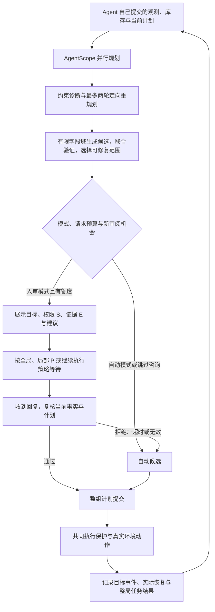

# 可修复范围与人审闭环：实现说明

日期：2026-11-16。本文对应当前代码；[原框架](research_framework_2026-11-16.md) 保留为设计依据。

## 1. 已接通的运行框架



MA-Crafter 继续使用原有 DAMCS 分层记忆、AgentScope Agent、导航和分享执行器。控制器在现有执行器之前统一提交计划补丁；不会直接发放材料或改写任务结果。普通导航不会因为未来缺工具而暂停，当前仍不可执行的制造或分享本步暂缓，下一步重新规划。

运行仍由单进程集中调度，各 Agent 的模型规划并发执行。本文没有把它描述为跨机器分布式运行。两轮重规划是每次规划周期的上限，API 重试与此分开计数。

## 2. 三个机制的实际边界

### 可修复编辑范围 S

`repair_scopes.py` 固定待恢复的制造/采集事件，枚举有限修改域，并按照真实的“先分享、再逐 Agent 执行动作”顺序联合投影。验证同时检查选定目标与未编辑计划原本可验证的工作；不会以全部等待作为修复。

选择依据依次为覆盖的即时目标数、采集目标数、编辑 Agent 数、修改字段数，即先修得全，再改得少。

2026-11-17 起，搜索默认不设编辑人数上限，按人数逐级加深：

- 1–2 人的范围总是完整搜索，H1 这类固定小范围策略仍能看到其中全部候选。
- 更大的范围只在还没有候选覆盖全部目标时继续搜索。一旦有候选覆盖全部目标，更大的范围只会多改人、不会被选中，所以停止。
- 联合检查总数超过预算 `ASSIGNMENT_BUDGET`（5 万次，Crafter 中约 4 秒）时停止，并在 `search_stop=assignment_budget` 中记录。
- 每次分析记录 `max_scope_agents`、`searched_scope_agents` 和 `search_stop`。

字段权限不变：只能改计划字段，不能改库存或环境，不可编辑的 Agent 不进入搜索。

现在有两个独立参数：

- `--scope_max_agents`（K）：搜索上限，默认不限。可设为 1 或 2，作为消融对照。
- `--review_max_agents`：一次人审最多开放的 Agent 数，默认 2，表示人的阅读上限。可修复范围超过该值时不发人审，记录 `review_skipped` 的 `over_review_capacity` 原因，然后走同一个自动后备分支。

自动分支使用同一份候选。人审批准并不代表恢复成功；只有实际执行产生对应成就或推块事件，才记为局部恢复。最后采到钻石或交付全部方块，另记为任务成功。

### 审阅证据 E

`review_evidence.py` 从库存读写、位置和格子读写构造依赖闭包，保留计划、位置、朝向、睡眠/死亡状态和原有保护义务作为背景。库存与局部观测按组删除；只有目标判定与保护义务仍能在缺失事实视为未知的模型中被证实时，才删除该组。

这里的“最小”是相对固定背景、以库存/观测组为粒度的删除极小，不是任意事实粒度的全局最小。充分性也只针对声明的一步规则模型，不保证人类一定理解。

CUBE 当前保留完整公开棋盘为一个事实组，不宣称已实现 CUBE 上的证据压缩收益。

### 等待范围 P 与增量复核

`intervention.py` 支持全局等待、依赖范围局部等待、继续执行三种模式。局部等待包含原计划和替代计划的读写影响，包括被取消的分享；等待期间新出现的相关操作也加入 P。分享在环境步进前发生，因此分享同样服从等待控制。

所有模式都推进环境时钟；等待的 Agent 执行 `noop`。未等待的 Agent 可以继续规划和行动。人工返回后检查权限、所审计划是否变化及当前联合条件；同一组修改在验证完成后一次性送入执行器。

增量模式对依赖范围复核。如果保留证据、原有保护义务、授权计划及建议均未变化，可复用已验证证书。完整复核作为可切换对照。环境中的后续 NPC、自主事件与未观测未来不在证书保证内。

## 3. 人审入口与预算

`--scope_mode human` 启动本地网页，默认地址 `http://127.0.0.1:8765`。界面提供目标、原计划、建议方案、授权字段、证据和候选选择；可以预检、采用建议、修改后提交或跳过。预检不修改模拟器。

每个发出的请求消耗一次 B，拒绝、超时和无效回复均不返还次数。阅读/修改时间单独记录；跳过咨询使用同一个自动后备分支。默认 B=3，超时 120 秒。`--review_step_seconds` 控制等待期间每个环境步的现实时间，实验各组应保持一致。

可用 `--reviewer scripted` 和 `--scripted_delay_steps` 检查固定延迟流程。此模式明确标记 `provider=scripted`，阅读时间为 0，不能进入真人增益统计。脚本采用建议本质上仍是自动选择，适合验证系统行为。

```powershell
python run.py --condition H2 --agent_num 6 --step_num 350 --human_requests 3 --review_max_agents 2 --pause_mode local --results_dir results\human_h2 --no_plot
```

需要单独运行表单服务时，使用 `python scripts\review_server.py --results_dir results\human_h2 --port 8765`，并将运行器的 `--review_port` 设为 0。

## 4. 对比与消融入口

正式要跑的三张表（主实验、部件消融、跨模型对比）及其统一设置、指标和运行前待办，见 [实验表设计](experiment_tables_2026-11-17.md)。主环境为 MA-Crafter，CUBE 只用于表 1 的 B、C、H2。2026-11-17 起补齐了运行三张表所需的部分：任意 OpenAI 兼容接口与命名模型配置（`config/model_profiles.json`、`scripts/run_with_model.py`）、独立的 Embedding 配置、表 2 的消融套件（`--suite ablation`，含 `--scope_selection any` 与 `--revalidation none`）以及钻石步数、改动人数和费用等汇总字段。

| 条件 | 最终行为 |
| --- | --- |
| A | 自主规划，统一动作合法性保护 |
| B | A + 最多两轮定向重规划 |
| C | B + 可修复候选自动选择、提交与执行 |
| H1 | C 的共同自动能力 + 按问题主体排序选择人审范围 |
| H2 | 共同自动能力 + 可修复范围人审 |

两个人审策略共用输入、候选有限域和容量；H2 进一步把开放字段收缩到所选见证的实际修改字段。`--review_strategy` 现在只接受 `verified`（H2）和 `owner`（H1）。

编号变更（2026-11-17）：旧方案中覆盖完整关联组、开放全部字段的结构参照（当时叫 H1）已删除，因为它允许人在较大范围内自由修改，结果难以量化；原来的 H0 改名为 H1。本文和其他文档中更早的 H0 即现在的 H1。

每局配置记录种子、重复编号、模型名称、Git 提交与当前源码 SHA256。正式条件都使用相同动作保护；兼容 API 中旧的诊断模式语义不用于区分保护强弱。

```powershell
# 先检查运行矩阵，不调用模型
python scripts\run_experiments.py --conditions A B C H1 H2 --seeds 4 5 6 --repeats 2 --dry_run --results_dir results\main_matrix

# 去掉 --dry_run 后，按矩阵顺序运行并保存每局结果
python scripts\run_experiments.py --conditions C H2 --seeds 4 5 6 --suite capacity --reviewer scripted --results_dir results\capacity
python scripts\run_experiments.py --conditions H2 --seeds 4 5 6 --suite evidence --results_dir results\evidence
python scripts\run_experiments.py --conditions H2 --seeds 4 5 6 --suite waiting --results_dir results\waiting

# 从真实运行冻结的同一批输入比较范围策略与联合条件
python scripts\evaluate_frozen_scopes.py --input results\main_matrix --capacities 1 2 --output results\frozen_comparison.json
```

等待消融包括全局等待+完整复核、继续执行+完整复核、局部等待+增量复核。逐问题与联合判断的消融在冻结快照上开展：逐问题见证可能争用同一资源或要求同一 Agent 执行不同操作，合并后再用联合验证检查其声称能否成立。这属于离线机制诊断；在线代码仍对所有提交实施联合检查。

批量输出 `episodes.csv/json` 保留完整局和技术失败，包含成功、步数、恢复、聊天与 Embedding 调用和 token、搜索时间、人工请求/时间、暂停 Agent 步数、复核次数及耗时。任务成功率应以完整局为单位，真人研究另外登记审阅者与次序；本次实现没有凭空生成统计显著性或人工收益结论。

## 5. CUBE 适配

采用 [COOP² 官方代码](https://github.com/HappyEureka/coop2-llm-mas) 中的 CUBE 环境，固定提交 `9c53341d77ba9757af2869b5bc8840f02480cd00`。`third_party/coop2_cube/UPSTREAM.json` 保存来源；MIT 许可证随代码保留。仅精简包入口，环境物理和任务规则保持原样。

适配器只使用各 Agent 收到的公开实体信息建立投影模型，验证同时施力、阻挡、未编辑移动与交付事件。规划使用独立的 AgentScope CUBE Agent 和五种动作，不套用 Crafter 的制造目标。人工预算、S/E/P、表单、联合提交与日志复用公共控制器。

```powershell
python run_cube.py --condition C --agent_num 3 --grid_size 9 --block_specs 2:1 --step_num 30 --results_dir results\cube --no_plot
```

## 6. 验证与仍需实验回答的问题

运行 `python -B -m unittest discover -s scripts -p "smoke_*.py"` 可检查 AgentScope、原约束与修复、实际 Crafter/CUBE 执行、人审 HTTP 表单、拒绝/超时/预算、证据与等待、提交与日志，以及批量矩阵与冻结快照。测试替代模型回复以复现明确的协调问题；HTTP 提交测试也不是真人实验。

本次验证结果：83 项自动检查全部通过，`pip check` 通过；7 个受控范围案例重新运行。真实 Qwen 短跑也正常结束：Crafter 为 2 Agent / 3 步，记录 5 次聊天和 16 次 Embedding 请求；CUBE 为 3 Agent / 2 步，记录 6 次聊天请求。这些短跑没有出现可修复的即时目标，不作为干预收益证据；干预提交、局部恢复及 CUBE 交付由可复现的实际环境测试验证。

本地原始记录位于 `results/completion_real_crafter_20261116`、`results/completion_real_cube_20261116_v2` 和 `results/completion_scope_examples`。模型耗时是请求耗时之和，包含并发请求；批量入口另外记录整个子进程的实际耗时，两者应分别分析。

目前实现的是一步机制及其完整在线验证入口。尚未用自然故障数据证明必须增加 2–3 步技能序列，因此没有提前加入通用多步求解器。真实人审是否优于获得相同候选的强自动基线、证据是否减少阅读成本、局部等待是否提高任务表现，都需要后续配对实验回答。
