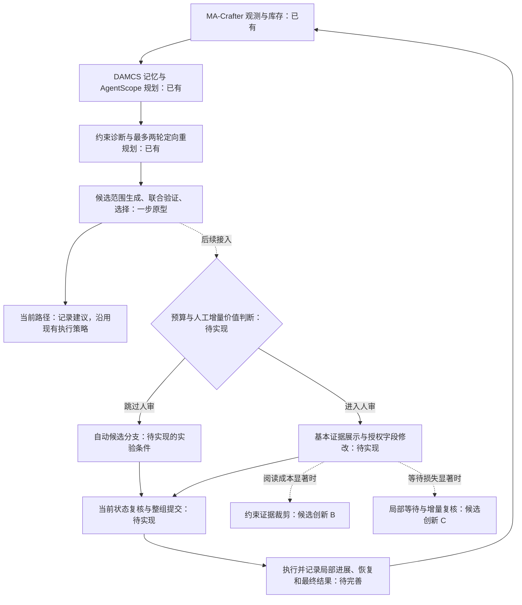

# 后续创新与系统框架

日期：2026-11-16。依据当前工作区代码和 2026-11-15 验证记录整理。本文是后续设计，未完成模块均明确标注。

> 实现后更新：候选在线执行、预算化人审、证据组裁剪、局部等待与增量复核、实验矩阵及 CUBE 最小适配现已接通。当前代码、运行方式和边界见 [完整实现说明](implementation_2026-11-16.md)。本文以下保留为实现前的研究设计，表中的“未实现”描述的是当时状态；多步扩展和真人收益仍须由自然故障与实际实验决定。

研究主线：面对耦合的多 Agent 计划，从可验证约束产生权限范围内可修复的编辑机会，再判断如何使用有限人工资源，并通过实际执行验证干预是否有用。

## 1. 当前完成到哪里

| 模块 | 当前状态 | 依据与边界 |
| --- | --- | --- |
| AgentScope、模型适配、DAMCS 记忆 | 已接入 | 运行与决策底座，分别规划、集中调度 |
| 约束诊断、定向重规划 | 已实现 | 观测与库存快照；最多 2 轮；当前不可执行操作暂缓 |
| 可修复范围生成、联合验证与选择 | 已有一步原型 | `repair_scopes.py`；最多编辑 2 个 AI Agent；覆盖制造材料和面前采集工具问题 |
| 候选改法与证据 Agent 列表 | 已记录 | 有具体见证、字段变化和证据涉及者；没有最小证据构造或人审展示 |
| 候选在线生效 | 未实现 | 当前 `scope_mode=suggest` 只记录建议，不执行候选 |
| 计划级人工审阅与预算 | 未实现 | 现有 HumanAgent 是手工动作入口，未形成预算化计划审阅 |
| 真实任务效果与人工增益 | 未验证 | 52 项检查、7 个受控案例支持机制正确性；不能推导完整任务收益 |

当前选择依据是覆盖目标数、编辑 Agent 数和字段数。编辑容量 K=2 与每局人审次数、实际阅读时间是不同的约束；后两者尚未实现。

## 2. 创新候选及剩余工作

### A. 主创新：可修复编辑范围生成与选择——已有原型，尚待完成

研究问题：给定合作约束、字段权限和编辑容量，哪些字段范围内确实存在联合可行的改法？这些范围何时优于按问题主体排序或按关联集合选择？

已有能力：固定目标事件、有限修改域枚举、联合资源与执行顺序验证、三值结果、编辑范围与证据范围区分。

剩余工作：

1. 收集真实运行中的失败、停滞与资源协调案例，判断一步模型覆盖多少实际问题。
2. 把建议接入明确的提交与执行入口，追踪真实目标事件及后续任务结果。
3. 在相同信息、权限和预算下比较范围策略；完整关联集合参照需与报告原有算法核对，当前示例脚本仅实现了简化参照。
4. 检查当前一步时域的不足。若真实故障主要涉及分享、制造、采集之间的跨步依赖，再增加少量 2–3 步技能序列，并在每个实际步骤更新观测、复核条件。
5. 多步结果必须标明适用假设和未知信息；未观测的未来状态不能作为已证实前提。

必要性：风险最大的 Agent 可能没有能力单方面改变所缺条件；将整个关联组全部开放，又可能浪费编辑容量。单独判断各个修改可行，还可能重复占用同一份资源。

成立证据：更高的范围内可修复比例、更少无效请求，以及在计算和人工成本计入后仍有实际恢复或任务收益。若简单关联选择已经同样有效，应据实缩小主张。

定位边界：[COOP²](https://arxiv.org/abs/2603.00349) 已研究约束失败预测和定向修复。候选差异须落在字段权限下范围如何产生、联合可修复性如何验证，以及这种信息如何改善选择，不能重复主张通用诊断和重规划。

### B. 配套创新：最小充分审阅证据——尚未实现，按阅读成本决定是否开展

研究问题：编辑范围确定后，人至少需要看到哪些事实与承诺，才能正确判断修改？

当前 `evidence_agents` 只列出了涉及的 Agent，尚未提取具体证据，也未判断哪些内容可省略。

拟实现机制：

- 从目标事件的前提、资源来源、未选计划承诺与候选改法中提取具体事实。
- 形成证据集 E：问题是什么、允许修改哪些字段、依赖哪些库存/位置/计划、修改可能影响谁、哪些事实未知。
- 按声明的局部约束模型检查证据是否保留本次判断所必需的条件，再生成便于阅读的展示。
- 阅读其他 Agent 的计划不扩大编辑权限 S。

必要性：S 很小，E 仍可能很大。全量日志增加阅读量，简单截断或摘要可能遗漏影响修复的资源承诺。

最小验证：固定同一个编辑范围、快照、界面和显示长度，比较完整相关上下文、等长度摘要/检索与约束证据。测阅读加修改时间、实际恢复和新错误。只有节省时间且保持决策效果，才有独立研究价值；模型层面的证据充分性不等于保证人类理解。

四周范围内先提供清楚的基本证据即可；若小试显示阅读成本显著，再把这一项提升为第二贡献。

### C. 架构备选：局部等待与增量复核——尚未实现，优先级较低

研究问题：人工审阅某个范围时，哪些执行必须等待，哪些可以继续？等待期间状态变化后，哪些条件需要重新检查？

需要区分：

- S：可以编辑的计划字段。
- E：审阅依赖的事实和承诺。
- P：为保护 E 而必须等待的执行范围。

拟实现机制：从技能实际读写与依赖关系计算 P；允许无关工作继续；回复返回后复核相关变化，确认整个联合修改仍适用再提交。分享发生在 `env.step` 之前，必须包含在同一执行控制范围内。

必要性必须先测量：人工等待较长且团队存在独立工作时，全局等待可能产生明显损失。若团队高度耦合或等待时间很短，局部执行的额外复杂度可能没有收益。

最小验证：在相同审阅输入、延迟及世界推进规则下，比较全局等待、继续执行后完整复核、依赖范围等待加增量复核。记录被阻塞 Agent 时间、过期回复、额外冲突、总任务表现与复核成本。不能让不同组的生命值或外生事件采用不同推进规则。

定位边界：[CoAgent](https://arxiv.org/abs/2606.15376) 已研究并发状态冲突、通知与计划修复。新增贡献需明确针对人工延迟、耦合计划和不可任意撤销的环境动作；普通版本号与锁属于支撑机制。

## 3. 必须补齐的闭环支撑

以下功能支持研究验证，分别实现并不自动构成新的论文贡献。

| 功能 | 最小实现 | 为什么需要 |
| --- | --- | --- |
| 候选在线提交 | 统一入口接受完整字段补丁，校验后一次性生效 | 建议可行不等于实际执行成功 |
| 计划级人工输入 | 展示 S、基本 E、当前目标和候选；只允许修改授权字段 | 当前手动选择动作不能替代范围审阅实验 |
| 预算控制 | 分别记录请求次数 B、编辑容量 K、人工阅读/修改时间 | 小编辑范围不能直接换算成人工时间节约 |
| 提交前校验 | 检查当前快照与计划、字段域及联合条件；整组应用 | 避免过期依据或半组修改使结果失真 |
| 执行反馈 | 连起建议、人工回复、校验、实际动作、局部目标和最终结果 | 批准、通过校验、恢复和任务成功必须分开 |
| 公平实验配置 | 开放 seed、条件、重复编号；记录源码与调用成本 | 当前种子固定且已有模式的保护策略不同 |
| CUBE 最小适配 | 核对任务和状态接口，复用范围概念并提供环境规则适配 | 用于检验迁移能力；接入第二环境本身属于验证 |

第一版人工闭环采用本地表单或 CLI、同步全局等待、统一执行器前的整组提交即可。基本快照/计划标识和字段校验服务于实际审阅一致性；复杂并发协议留到 C 的必要性成立后。

## 4. 整体框架

图中“已实现”的范围生成阶段当前只输出建议。所有提交、人工和反馈分支均属于下一阶段设计。

预算门控第一版应采用预先说明的简单政策，并记录触发原因。未知事实与模型未覆盖的问题不能被包装成已验证可修复范围；补充信息类咨询需单独标记。

如果当前候选已经可以自动执行，强自动基线必须获得同样候选及权限。人工分支的价值要相对“不咨询、自动选择并执行候选”来测量，例如对后续资源取舍和任务进展是否有帮助。当前用户确认的两轮重规划策略保持为现有条件，候选自动执行需要新增明确可切换的实验条件。

[CVD](https://arxiv.org/abs/2611.05814) 已研究有限人工咨询预算的价值分配。通用预算分配不宜单列为本项目独立创新；本项目应研究它与结构化可修复范围、权限及真实审阅成本之间的关系。

## 5. 最小实验框架

所有组统一在线信息、可修改字段、任务配置、共同动作合法性保护，以及无关的模型/记忆/通信设置。人工组另外统一请求与编辑容量；记录实际人工时间和推理开销。

| 条件 | 用途 | 当前差距 |
| --- | --- | --- |
| A：自主规划 + 共同执行保护 | 基础对照 | 需要规范共同保护与条件参数 |
| B：A + 最多两轮定向重规划 | 测自动重规划作用 | 核心机制已有 |
| C：B + 候选自动选择并执行 | 检验范围搜索本身及强自动恢复 | 候选已有，提交执行未接入 |
| H0：C 的共同自动能力 + 问题排序人审 | 选择策略对照 | 人工闭环与在线排序未实现 |
| H1：共同自动能力 + 完整关联范围人审 | 与报告范围覆盖策略比较 | 当前只有受控脚本简化参照，需核对原算法 |
| H2：共同自动能力 + 可修复范围人审 | 主方法 | 范围内核已有，人工与在线实验待补 |

人工机会出现在候选提交之前；跳过咨询时使用同一个自动执行后备分支。不得先把所有候选提交完，再给人工组安排不同的失败分布。

现有 `off / diagnose / repair` 是工程开关，其中前两者不会暂缓违规操作，不能直接视为已经满足共同保护要求的正式对照组。需把执行保护与修复策略的开关明确分开。

核心指标：

- 范围内可修复比例、无效推荐/请求、实际恢复率。
- 任务成功与完成成本、聊天/Embedding 调用和搜索耗时。
- 人工阅读加修改时间、请求量、越权或过期修改的结果。
- 以完整局和审阅者为统计单位，保留失败局与技术错误，不把同一局的多个快照当独立重复。

关键消融优先比较联合验证与逐问题判断、结构化范围与固定关联范围、容量 K 的变化。证据或局部等待只有实际开展时才增加对应消融。

## 6. 后续优先顺序

1. **先完成 A 的在线执行验证**：冻结自然故障快照、核对范围参照，接入明确的候选提交和真实事件记录，建立 C。
2. **再做最小预算化人工闭环**：基本证据、授权字段、同步等待、整组提交，比较 H0/H1/H2 与 C。是否存在人工增量价值由结果决定。
3. **按自然故障决定多步扩展**：先少量 2–3 步例子，逐步刷新观测；不直接扩成通用规划系统。
4. **按阅读数据决定 B**：先有基础证据和真实用时，再开展最小充分证据研究。
5. **按等待数据决定 C**：先测全局等待损失，再决定是否投入局部等待架构。

四周目标优先保留一项主创新及其最小对照。B 和 C 是有前提的候选扩展，不作为同时必须完成的承诺。

## 7. 报告章节框架

1. 问题与研究假设：耦合计划、字段权限、有限编辑/人工容量与信息边界。
2. 已有底座与自动基线：AgentScope、DAMCS、诊断和定向重规划。
3. 主方法：修复目标、候选有限域、联合可修复性、范围选择与未知处理。
4. 在线干预闭环：基本证据、预算、授权编辑、提交与执行反馈。
5. 实验：强自动对照、范围策略、容量和联合验证消融、自然失败分析与成本。
6. 讨论：模型与时域限制、人工价值成立条件、跨环境结果；B/C 仅在完成并取得证据后列为贡献。
